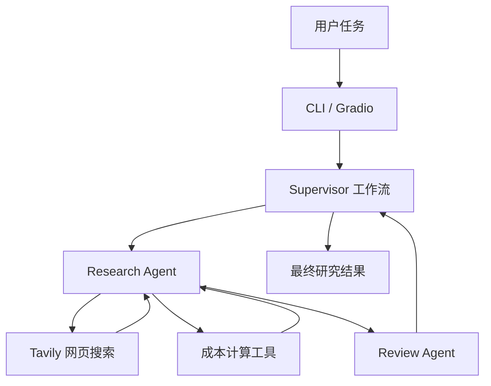

# LangGraph Multi-Agent Supervisor

一个基于 **LangGraph、LangChain 和 SiliconFlow** 构建的多智能体行业与商业研究助理。项目通过 Supervisor 编排专业 Agent，结合真实网页搜索、确定性成本计算和报告审查，探索多智能体协作系统的工程化实现。

项目重点包括模块化架构、Agent 协作、工具调用、信息来源核查、自动化测试和可交互演示。

> 本项目用于学习、技术验证与作品集展示。模型输出、网页搜索结果及成本估算受数据来源、计算假设、模型价格和运行时配置影响，不应直接作为生产环境的正式报价或投资建议。

## 项目亮点

- **Supervisor 多智能体编排**：集中管理专业 Agent 的任务分配与结果整合。
- **Research Agent**：负责行业与商业研究，按任务需要使用网页搜索和相关工具。
- **Review Agent**：审查研究报告中的事实依据、计算结果、数据口径和潜在错误，并区分已确认信息与待核实信息。
- **真实网页搜索**：通过 Tavily 获取外部网页搜索结果，支持研究时参考来源标题、链接和摘要。
- **确定性成本计算**：使用 Python 工具计算 LLM 调用成本，避免完全依赖模型进行算术运算。
- **模块化工程结构**：分离 Agent、模型配置、业务服务、工具、工作流编排和测试代码。
- **多种运行入口**：提供命令行入口与 Gradio Web 演示界面。
- **自动化测试**：使用 Python `unittest` 验证工具、业务服务和多智能体相关逻辑。

## 系统架构



图示表示项目的主要多智能体协作设计。具体执行路径取决于入口、任务类型和工作流配置；并非每次请求都会调用所有工具或 Agent。

### 核心执行流程

1. 用户提交行业研究、成本分析或报告审查任务。
2. Supervisor 根据任务安排专业 Agent。
3. Research Agent 根据需要检索网页资料或调用成本计算工具。
4. Review Agent 对相关结论进行复核，检查数据、假设、逻辑和来源。
5. 工作流整合结果，并向用户返回最终回答。

对于 Gradio 中的成本分析任务，业务服务会直接调用成本计算工具，再根据工具结果生成报告；该路径不应与完整的 Supervisor 工作流混为一谈。

## 技术栈

| 类别 | 技术 |
|---|---|
| 编程语言 | Python 3.12+ |
| Agent 工作流 | LangGraph、`langgraph-supervisor` |
| Agent 与工具 | LangChain、`langchain-openai` |
| 模型服务 | SiliconFlow，OpenAI 兼容 API |
| 网页搜索 | Tavily、`langchain-tavily` |
| 配置管理 | `python-dotenv` |
| Web 演示 | Gradio |
| 自动化测试 | Python `unittest` |

## 项目结构

```text
langgraph-multi-agent/
├── agents/
│   ├── research_agent.py
│   └── review_agent.py
├── config/
│   └── model.py
├── services/
│   ├── research_service.py
│   └── result_reporter.py
├── tools/
│   ├── cost_calculator.py
│   └── web_search.py
├── tests/
│   ├── helpers.py
│   ├── test_consistency_check.py
│   ├── test_cost_calculator.py
│   ├── test_fixed_workflow.py
│   ├── test_model.py
│   ├── test_research_agent.py
│   ├── test_research_service.py
│   ├── test_research_tool_usage.py
│   ├── test_review_search.py
│   ├── test_supervisor.py
│   ├── test_supervisor_research.py
│   └── test_tavily.py
├── app.py
├── graph.py
├── main.py
├── requirements.txt
├── .env.example
├── .gitignore
└── README.md
```

各模块的主要职责：

- `agents/`：定义专业 Agent 的角色、提示词和工具使用方式。
- `config/`：统一管理模型初始化和配置。
- `services/`：封装业务执行流程及结果汇总。
- `tools/`：提供网页搜索、成本计算等可复用工具。
- `graph.py`：组装 Supervisor 多智能体工作流。
- `main.py`：提供命令行运行入口。
- `app.py`：提供 Gradio 交互式演示入口。
- `tests/`：保存自动化测试与测试辅助代码。

## 运行环境与配置

### 1. 克隆项目

```powershell
git clone https://github.com/feib922/langgraph-multi-agent.git
cd langgraph-multi-agent
```

### 2. 创建虚拟环境并安装依赖

Windows PowerShell：

```powershell
py -3.12 -m venv .venv
.\.venv\Scripts\Activate.ps1
python -m pip install --upgrade pip
pip install -r requirements.txt
```

如果系统没有 `py -3.12`，请使用本机 Python 3.12 的可执行文件创建虚拟环境。

### 3. 配置环境变量

在项目根目录创建 `.env` 文件，并参考 `.env.example` 配置自己的密钥和 API 地址。

```dotenv
SILICON_FLOW_API_KEY=your_api_key_here
SILICON_FLOW_API_URL=https://api.siliconflow.cn/v1
```

请根据实际配置补充 Tavily API Key。具体变量名以项目中的 `.env.example` 和 `tools/web_search.py` 为准。

**安全要求：**

- 不要将真实 API Key 或其他凭据提交到 Git。
- `.env` 应保持在 `.gitignore` 中。
- 公开仓库仅提交不包含真实密钥的 `.env.example`。

## 运行方式

### 方式一：命令行运行

成本分析：

```powershell
.\.venv\Scripts\python.exe main.py --mode cost_analysis
```

报告错误审查：

```powershell
.\.venv\Scripts\python.exe main.py --mode review_error
```

这两个模式通过命令行入口调用 Supervisor 工作流，并输出执行摘要和最终回答。

成本分析示例采用以下假设：

- 每天 200 次问答，每次输入 3,000 Token、输出 500 Token。
- 输入价格为每百万 Token 2 元，输出价格为每百万 Token 8 元。
- 每月按 30 天计算。

由此得到：

| 指标 | 结果 |
|---|---:|
| 单次输入成本 | 0.006 元 |
| 单次输出成本 | 0.004 元 |
| 单次合计成本 | 0.01 元 |
| 每月请求量 | 6,000 次 |
| 每月估算成本 | 60 元 |

以上是给定假设下的计算结果，不代表任何模型的固定价格。真实业务还需考虑实际上下文长度、重试、缓存及其他调用开销。

报告审查模式用于检查给定报告中的计算错误和不合理结论。例如，若报告将上述条件下的月度成本写成 600 元，应重新计算并指出正确结果为 60 元。

### 方式二：Gradio Web 演示

在项目根目录运行：

```powershell
.\.venv\Scripts\python.exe app.py
```

根据终端输出打开本地访问地址，通常为 `http://127.0.0.1:7860`。

演示界面支持三种任务类型：

1. **行业研究**：检索与分析行业信息，并整理研究结果。
2. **成本分析**：调用成本计算工具，根据实际计算结果生成成本分析报告。
3. **报告审查**：审查用户提供的报告，检查计算结果、事实依据和逻辑错误。

实际网页搜索能力取决于 API 配置、网络连接和工具调用是否成功。

## 测试与验证

在项目根目录执行完整测试：

```powershell
.\.venv\Scripts\python.exe -m unittest discover -s tests -v
```

当前本地验证记录（2026-10-26）：

| 验证项 | 结果 |
|---|---|
| `main.py` 语法检查 | 通过 |
| `app.py` 语法检查 | 通过 |
| `app` 模块导入检查 | 通过 |
| 单元测试 | 10 项通过 |
| 命令行成本分析 | 已验证运行成功 |
| 命令行报告错误审查 | 已验证运行成功 |

上述记录反映当前开发环境中的验证情况，不代表所有外部 API、部署环境和自然语言任务都已覆盖。

## 技术难点与设计思路

### 1. 多智能体职责划分

通过 Supervisor 统一调度，将研究、审查和工具执行职责分离，降低所有逻辑集中在单一入口文件中的维护成本。

### 2. LLM 与确定性计算结合

将成本计算封装为 Python 工具。模型负责理解需求、组织分析和解释结果，程序负责确定性计算，以便独立测试和复核。

### 3. 研究结果的来源核查

使用网页搜索获取外部资料，并让审查流程关注来源、时间、统计口径和数据之间的一致性。搜索结果可作为核查线索，但不应把单一网页的陈述直接视为已证实事实。

### 4. 模块化与自动化测试

将 Agent、配置、服务、工具和测试分别组织，降低模块间耦合，并通过自动化测试减少后续重构引入回归问题的风险。

### 5. API 配置与密钥安全

使用环境变量管理 API 配置，避免在代码中硬编码凭据，并通过 `.env.example` 为开发环境提供配置模板。

## 后续改进方向

- 为 Supervisor 路由、工具调用和执行结果补充更细致的自动化断言。
- 增强研究报告的来源列表、引用格式和证据追踪能力。
- 为 Review Agent 增加可评估的事实核查案例与错误率指标。
- 增加超时、重试、异常处理和 API 调用成本记录。
- 为成本计算加入可配置的模型价格与 Token 参数。
- 增加端到端演示、运行截图和测试报告，完善项目作品集展示。

## 安全说明

- 不要提交 `.env`、API Key、访问令牌或其他凭据。
- 公开仓库前检查 Git 历史，确认没有遗留已提交的密钥。
- 成本估算和研究结论仅供参考，使用前应核实假设、价格和来源。

## 作者

GitHub：[feib922](https://github.com/feib922)

欢迎通过 GitHub Issues 反馈问题或提出改进建议。
