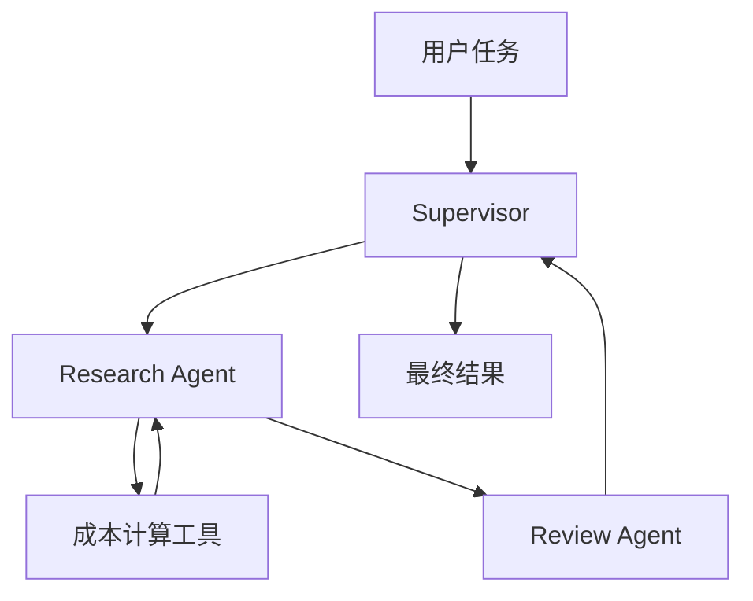

# LangGraph Multi-Agent Supervisor

一个基于 **LangGraph、LangChain 和 SiliconFlow**
构建的多智能体协作示例。系统通过 Supervisor 统一调度专业
Agent，完成成本分析与结果审查，展示了多智能体工作流、工具调用、结构化协作和自动化测试等核心实践。

> 本项目用于学习与演示。模型输出和成本估算依赖输入假设、模型价格及运行时配置；示例结果不应直接视为生产环境报价。

## 项目亮点

- **Supervisor 编排**：由 Supervisor 负责选择任务执行路径，并汇总专业
  Agent 的结果。
- **专业化分工**：Research Agent
  负责分析任务并按需调用成本计算工具；Review Agent
  对报告进行复核，检查假设、遗漏和风险。
- **工具调用**：使用 LangChain `@tool`
  封装成本计算逻辑，让模型能够调用确定性的 Python 函数完成计算。
- **兼容 OpenAI API 的模型接入**：通过 `ChatOpenAI` 连接 SiliconFlow
  API，并使用环境变量管理配置。
- **可重复验证**：包含单元测试与 Supervisor 工作流测试；当前本地验证中
  8 项测试全部通过。

## 多智能体架构



### 执行流程

1. 用户选择运行模式并提交任务。
2. Supervisor 根据任务将工作交给 Research Agent。
3. Research Agent 分析输入；需要数值计算时调用成本计算工具。
4. Review Agent 审查结果中的假设、遗漏与潜在风险。
5. 结果返回 Supervisor，由其整合并输出最终回复。

该流程体现了**集中式调度 + 专业 Agent 分工 +
审查反馈**的设计。具体路由行为以代码和模型输出为准。

## 技术栈

类别           技术

---

语言           Python 3.12
Agent 工作流   LangGraph、`langgraph-supervisor`
LLM 接入       LangChain、`langchain-openai`、OpenAI-compatible API
模型服务       SiliconFlow（示例模型：`deepseek-ai/DeepSeek-V4-Flash`）
配置管理       `python-dotenv`
测试           Python `unittest`

## 运行环境与配置

- Python 3.12+
- 可访问 SiliconFlow API 的网络环境
- SiliconFlow API Key

### 1. 克隆项目

```powershell
git clone https://github.com/feib922/langgraph-multi-agent.git
cd langgraph-multi-agent
```

### 2. 创建并激活虚拟环境（Windows PowerShell）

```powershell
py -3.12 -m venv .venv
.\.venv\Scripts\Activate.ps1
python -m pip install --upgrade pip
pip install -r requirements.txt
```

如果系统没有 `py -3.12`，请使用本机已安装的 Python 3.12
可执行文件创建虚拟环境。

### 3. 配置环境变量

在项目根目录创建 `.env` 文件。请参考 `.env.example`
中的变量名称，填写自己的 SiliconFlow API Key 和 API 地址。

示意配置（请以仓库中的 `.env.example` 为准）：

```dotenv
SILICON_FLOW_API_KEY=your_api_key_here
SILICON_FLOW_API_URL=https://api.siliconflow.cn/v1
```

请勿把真实 API Key 提交到 Git。`.env` 应保持在 `.gitignore`
中；公开仓库只提交不含真实密钥的 `.env.example`。

## 运行示例

### 成本分析模式

```powershell
python main.py --mode cost_analysis
```

该模式会启动 Supervisor 协作流程，由 Research Agent
分析成本参数并调用成本计算工具，再由 Review Agent
检查结论，最后返回整合后的结果。

示例验证中，按 **0.01 元/次、每月 6,000 次**的假设，月度调用成本估算为
**60
元**。这是演示计算，不代表固定模型价格；实际成本需要根据所选模型、输入输出
Token、价格变化和额外调用开销重新计算。

### 结果审查模式

```powershell
python main.py --mode review_error
```

该模式用于演示另一条任务路径：将待审查内容交给多智能体流程进行分析与复核。实际输入和输出格式请以当前代码实现为准。

## 测试与验证

运行项目测试：

```powershell
python -m unittest test_cost_calculator test_supervisor -v
```

当前已完成的本地验证：

---

验证项                              结果

---

成本计算工具测试                    通过

Supervisor 工作流测试               通过

测试总数                            8 项通过

`cost_analysis` 端到端运行          成功

典型协作路径                        Supervisor → Research Agent →
成本计算工具 → Review Agent →
Supervisor 汇总
---------------

端到端验证确认系统可以调用 SiliconFlow 模型并完成一次协作流程。由于 LLM
输出具有非确定性，测试通过不等于所有自然语言任务都能得到完全一致的结果。

## 技术难点与处理思路

### 1. 多智能体职责边界与流程编排

**挑战：** 多个 Agent
参与任务时，容易出现职责重叠、流程不清晰或结果难以整合的问题。

**处理思路：** 将调度职责集中到
Supervisor，并把分析、计算和审查拆分给不同角色；通过端到端运行观察实际路由，验证
Agent 之间能否完成交接与结果汇总。

### 2. LLM 推理与确定性计算的结合

**挑战：** 让模型直接完成算术可能产生计算误差，也不利于单元测试。

**处理思路：** 将成本计算封装为 Python 工具，由 LLM
负责理解任务和组织步骤，由工具执行确定性计算，再把结果交给审查 Agent
复核。

### 3. 结果审查与成本假设透明化

**挑战：** 成本估算很容易忽略输入输出
Token、提示词长度、历史上下文、重试、缓存以及模型价格变化等因素。

**处理思路：**
在审查阶段显式检查估算假设与潜在风险；输出成本结论时说明计算口径，避免将示例估算误当作生产环境的精确账单。

### 4. API 配置与密钥安全

**挑战：** 本地开发需要连接外部模型服务，同时避免将密钥提交到公共仓库。

**处理思路：** 使用 `python-dotenv` 从 `.env` 加载配置，将 `.env` 加入
`.gitignore`，仅保留无真实密钥的 `.env.example` 作为配置模板。

## 项目结构

```text
langgraph-multi-agent/
├── main.py
├── requirements.txt
├── README.md
├── .env.example
├── .gitignore
├── test_cost_calculator.py
├── test_model.py
└── test_supervisor.py
```

> 以上列出主要入口、配置和测试文件。若仓库中还有其他模块或目录，可在后续维护时补充完整结构说明。

## 后续改进方向

- 增加对 Agent 路由路径、工具调用次数和最终状态的自动化断言。
- 为成本计算加入明确的模型价格配置，并区分输入、输出 Token
  及不同调用阶段。
- 增加失败重试、超时控制和 API 异常处理测试。
- 记录每个 Agent 的输入输出摘要与耗时，方便排查问题和分析调用成本。
- 在更多任务样例上评估 Supervisor 的路由稳定性与 Review Agent
  的审查效果。

## 安全说明

- 不要提交 `.env`、API Key、访问令牌或其他凭据。
- 公开前检查 Git 历史，确认没有曾经提交过的密钥。
- 示例中的成本数字仅用于演示，请在实际使用前核对当前模型价格与业务假设。

## 作者

GitHub: [@feib922](https://github.com/feib922)

---

如果你发现问题或有改进建议，欢迎通过 GitHub Issues 记录。
